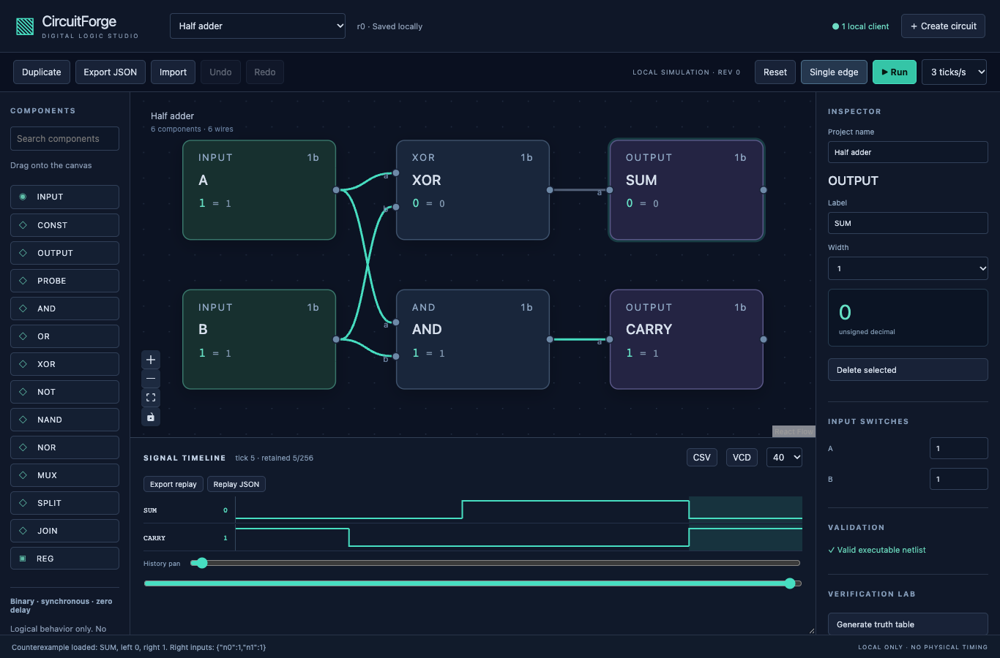
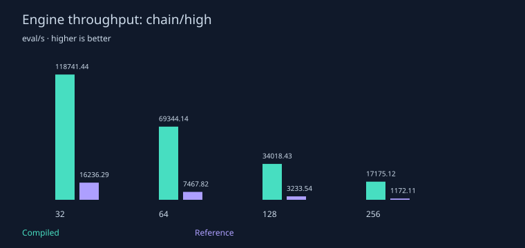
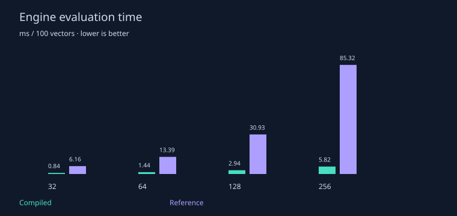
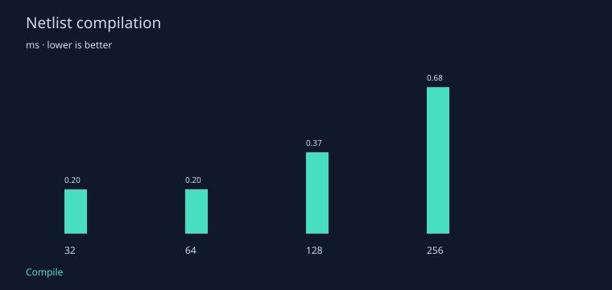
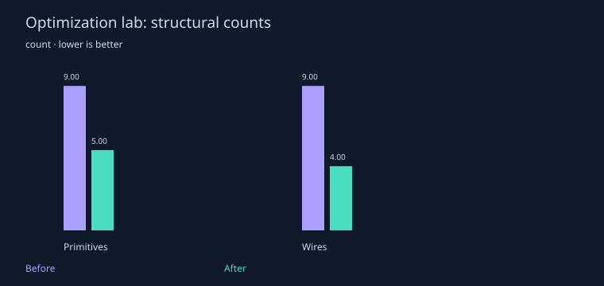
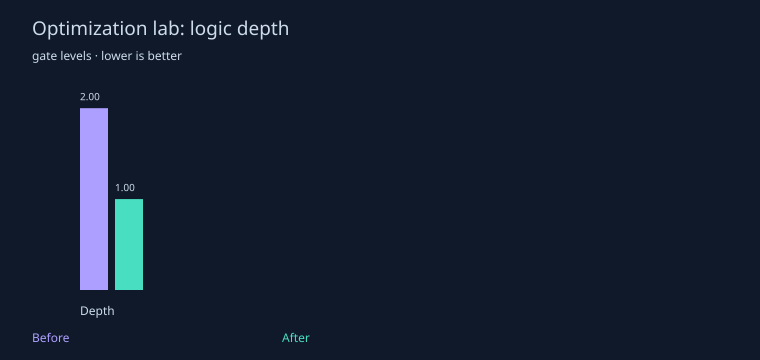
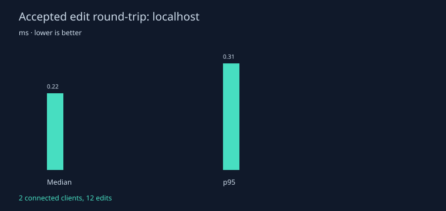

# CircuitForge

[](https://github.com/mirmoosa1014-rgb/circuit-forge/actions/workflows/ci.yml)

A local digital-logic workbench for drawing circuits, clocking registers, inspecting waveforms, finding counterexamples, and editing a shared project in two browser windows. React canvas, TypeScript engine, browser worker, local WebSocket server, and SQLite storage. No external service is needed after installation.



## Run locally

Use Node **24.18 or newer**. From this directory:

```sh
npm ci
npm run dev
```

Open **http://127.0.0.1:5173**. The development command starts the UI and local server together. For a single production origin:

```sh
npm run build
npm start
```

Open **http://127.0.0.1:3001**. Use a second browser window for collaboration. Projects save automatically to `.data/projects.sqlite`; this personal storage is ignored by Git. Opening the folder in VS Code provides development and check tasks.

## Working features

- Palette and editable canvas with wires, drag/drop, pan/zoom, multiselection, copy/paste, delete, and undo/redo. Project creation, rename, duplicate, import, and export.
- Binary buses from 1–16 bits; gates, muxes, splitter/joiner, constants, probes, synchronous registers with reset and optional enable.
- Validation of required pins, widths, multiple drivers, combinational cycles, hierarchy recursion, and resource bounds. Deterministic hierarchical flattening uses stable namespaces.
- Single-edge or bounded continuous simulation in a worker, input switches, retained waveforms, cursor, zoom/range, history pan, CSV/VCD, testbench execution, and hashed deterministic replay.
- Exhaustive truth tables and combinational equivalence for **at most 12 total input bits**. Concrete counterexamples load the failing inputs and select the differing output.
- Optimization creates a separate, exhaustively checked copy using constant folding, identities, structural sharing, and dead-logic removal. Reports actual component/wire/depth counts.
- Revisioned collaboration, presence/cursors/selections, independent local simulation, conflict drafts, retry handling, reconnect snapshots, and SQLite recovery.
- Editable half/full adders, a hierarchical ripple adder, a 4-bit ALU, an 8-bit counter, traffic lights, optimization and fault demonstrations. Verilog and generated HDL testbench export.

See [90-second demo](docs/demo.md), [semantics](docs/simulation-semantics.md), [architecture](docs/architecture.md), [verification](docs/verification.md), and [collaboration](docs/collaboration.md).

## Evidence and checks

```sh
npm run lint
npm run typecheck
npm test
npm run build
npm run bench               # quick measured workloads
npm run bench -- --full      # larger bounded workload
npm run test:protocol        # two clients + server restart
npm run test:export          # Icarus, if installed
npm run evidence            # fresh server, browser checks, measurements, exports
```

For evidence capture, install Google Chrome on macOS, or run `npx playwright install chromium` on Linux and set `CI=1`. Icarus Verilog is an optional independent check (`brew install icarus-verilog` on macOS / `apt-get install iverilog` on Linux). Core operation does not invoke it. CI requires it for export verification.

Measured results, environment, raw samples, and limitations are in [the benchmark report](docs/benchmarks.md) and [results](results). The local suite checks all 1,024 ALU input/operation combinations, all 512 ripple-adder input/carry combinations, invalid circuits, register scheduling, replay, optimization, and real clients. [Export results](results/verilog.json) record the independent simulator status; [browser results](results/browser.json) record the UI checks. Hosted CI status must be checked on GitHub after publication.


On the measured Apple M4 / Node v24.18.0 quick run, a 256-gate `chain/high` workload took **5.82 ms per 100 compiled evaluations** (about 17,175 evaluations/s), versus 85.32 ms for the deliberately simple recursive reference evaluator. Compilation median was 0.675 ms. These are nine-trial medians after two warmups; reference evaluation includes its simple hierarchy-copy overhead.

The two-connected-client localhost check measured **0.221 ms median** / 0.306 ms p95 acknowledgment latency across 12 edits. The optimization example changed from 9 to 5 components, 9 to 4 wires, and depth 2 to 1, with exhaustive equivalence passing. These observations do not predict other machines or physical hardware.








## Headless tools

```sh
npm run cli -- truth examples/0-half-adder.json
npm run cli -- compare examples/0-half-adder.json examples/6-faulty-half-adder.json
npm run cli -- testbench examples/4-8-bit-synchronous-counter.json examples/counter.testbench.json
npm run cli -- verilog examples/2-hierarchical-4-bit-ripple-carry-adder.json circuit.v
```

These use the same engine as the editor. `npm run examples` regenerates the checked-in JSON circuits from their structural generators.

## Scope and limits

This is a binary, synchronous, zero-delay educational model. Logical ticks do not represent physical propagation delay. There is no analog behavior, metastability modeling, hardware validation, technology mapping, power estimate, sequential equivalence proof, arbitrary Verilog import, or SAT solver. Counts and depth are structural proxies.

The server binds to loopback and is a trusted local demonstration without accounts or public-service authentication. Keep it local. Structural editing pauses during disconnection; conflicting drafts must be exported or explicitly discarded. Undo history is cleared by remote edits. The wave buffer retains 256 frames; imports/messages are limited to 512 KB, flattened circuits to 1,000 components, and exhaustive domains to 4,096 assignments. See [progress and remaining limitations](docs/progress.md) for the current acceptance audit.

New code is [MIT licensed](LICENSE). [Third-party notices](THIRD_PARTY_NOTICES.md) list core dependencies. AI assistance was used to implement, test, and document the project; no claim is made that the owner independently authored all of this code.
