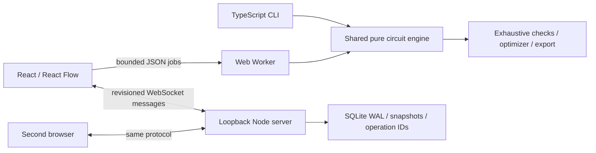

# Architecture

`engine.ts` owns schema, bit operations, flattening, compile/evaluate/step, the independent reference evaluator, exhaustive tools, and optimization. `formats.ts` owns testbenches, CSV/VCD, and generated HDL. `replay.ts` hashes the complete versioned circuit and replays recorded events. `protocol.ts` implements object-level conflict comparison separately from storage and transport. `server/index.ts` validates all imported/server data and persists authoritative revisions. The UI displays worker outputs; examples are netlists, not separate arithmetic demos.

The compiler treats register outputs as state sources and performs deterministic dependency traversal for combinational nodes. The worker caches its compiled circuit by structural content; layout-only top-level edits do not change the engine key. The UI also compiles to give immediate validation feedback. Definition edits conservatively invalidate the worker cache.

Hierarchy definitions live in the project JSON. Instances refer to a shared definition key. Flattening substitutes boundary inputs/outputs with probes, deterministically prefixes instance IDs with `__`, and rewires named ports. Namespaced IDs map back to their instance and original component. Definitions may reuse other definitions; recursion and expansion beyond 1,000 components / 16 levels are rejected. A definition can be edited as JSON in the inspector or expanded into a separate editable copy.

SQLite uses Node's built-in adapter, requiring the documented Node version. Database state stays outside Git. Accepted project content, revision, and operation ID commit in one transaction. The previous 100 revisions support stale-edit comparison. Personal names and external accounts are not part of this protocol.

The default target is a laptop viewport of 1366×900, netlists in the tens to hundreds of primitives, 256 retained trace frames, and 1–30 displayed edges/s. These are operating bounds, not measured FPS guarantees. Benchmark timing excludes canvas rendering.

Web Workers follow the [MDN execution model](https://developer.mozilla.org/en-US/docs/Web/API/Web_Workers_API). Screenshot evidence is captured using [Playwright](https://playwright.dev/docs/screenshots); it is never generated artwork.
